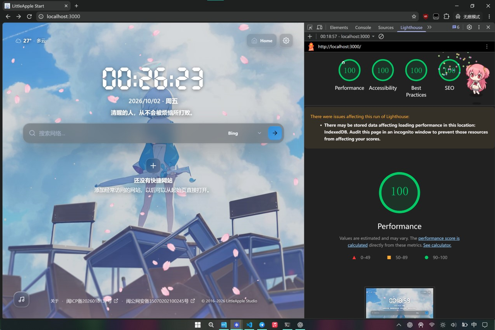

# LittleApple Start Community Edition

> Your new tab, under your control.

[DEMO](https://start.nekro.top/) | [简体中文](README.md)

LittleApple Start Community Edition is a browser start page based on [LittleApple Start Page](https://www.littleapple.top/startweb.html). You can customize the background, theme, and homepage layout. Configuration and uploaded assets are stored in your browser.

## Preview



## Core Features

### Appearance

* Personalized wallpapers: supports image and video backgrounds with fill, fit, stretch, tile, and center layout modes.
* Fine-grained controls: customize wallpaper focal point, overlay opacity, blur strength, and effects such as falling Sakura petals.
* Palette extraction and accent colors: includes a preset palette, can extract tones from custom images, and supports manually specified accent colors.
* Theme materials: Light, Dark, and System modes are paired with three themes: Simple (Content First), Material (Color First), and Liquid Glass (Environment First, the default).
* Flexible composition: adjust overall and per-module scale, spacing, and the position of interface elements.

Material uses M3-inspired color roles and tonal containers. Liquid Glass uses refraction on a few focal surfaces such as Search; Quick Links and the Settings shell use CSS materials. Icon styles are Auto, Feather, and Material Symbols. Auto uses Material Symbols for fixed UI in Material and Feather in Simple and Liquid Glass. Custom Top Actions use their saved icon provider.

### Modules

* Clock and date: supports multiple time zones, 12/24-hour format, seconds, and multiple date formats.
* Search and translation: manage search engines, choose or configure suggestion APIs and proxies, and toggle suggestions per engine. External translation entries support Baidu, Google, Bing, and custom links.
* Quick links and actions: reorder Quick Links by dragging, upload local icons, or fetch icons declared by each webpage. Links show their initial letter until an icon is available, then cache it locally. Top Actions support custom links and icon providers.
* Focus Mode: hide homepage modules to view the background.
* Quotes and weather: Hitokoto is enabled by default, with cached or preset text on failure. Optional Open-Meteo weather supports city input, browser location, temperature units, display options, and refresh intervals.
* Audio: supports independently managed background audio stored in the browser and an APlayer playlist with network audio, cover, and LRC lyrics URLs. APlayer also has an optional experimental Meting integration for song, playlist, album, search, and artist resolution.
* Footer: supports custom copyright text and optional ICP and public-security filing information.
* Settings search: find settings across categories from the header search field.
* App installation: PWA installation entry and an offline notice, with installation options determined by the browser.

### Experimental Features

* Custom cursor: upload an image and adjust its size and hotspot on desktop. Mobile devices cannot enable it.
* Background audio: upload local audio and control playback from Experimental settings.
* Model API: manage multiple OpenAI-compatible Chat Completions connections, specify an endpoint and model, and test connections manually.
* AI translation: choose a model, translate the current input from the search candidate popup, and copy the result. Target languages are Simplified Chinese, Traditional Chinese, and English. External translation links remain available.

Model API and AI translation are off by default. Connection tests and translations may incur API charges. API keys remain in session memory, must be entered again after a reload, and are excluded from exports. The browser sends requests directly to the selected endpoint, subject to its CORS policy. Remote endpoints require HTTPS; localhost/loopback development endpoints may use HTTP.

## Tech Stack

* Framework and language: Next.js 16 (App Router) / React 19 / TypeScript
* Styling and UI: Tailwind CSS 4 + CSS Variables / Feather Icons / bundled Material Symbols SVGs / liquid-glass
* Interaction and storage: dnd-kit / IndexedDB + LocalStorage / APlayer
* Testing and quality: Vitest / ESLint

## Deployment

The project needs no server database. Runtime environment variables can set site defaults and a favicon. User configuration and uploaded assets are stored in the browser.

### Deploy with Vercel (Recommended)

1. Import the repository into [Vercel](https://vercel.com/).
2. Select Next.js as the Framework Preset, or use the automatically detected value.
3. Keep the default build configuration. Vercel detects pnpm from `pnpm-lock.yaml`, installs dependencies, and runs `pnpm build` automatically. To enforce pnpm 10.32.0 from `packageManager`, enable `ENABLE_EXPERIMENTAL_COREPACK=1` in the project environment variables.
4. Open the assigned deployment URL after the deployment completes.

### Deploy Manually with Docker

> The project uses a Next.js standalone production image based on Node 24 Alpine and runs on port 3000.

```bash
docker build -t littleapple-start .
docker run --rm -p 3000:3000 littleapple-start
```

> Open `http://localhost:3000` after the container starts.

### Install as an App (PWA)

Open Settings → Content → App installation, click "Install as app", and confirm in the browser dialog. The button becomes available when the browser offers an install event. Otherwise, use the browser's installation menu; on iPhone/iPad, choose Share → Add to Home Screen. Deployment requires HTTPS; localhost works for local testing.

The installed app uses the LittleApple Start product name and bundled icons. The site Logo and browser favicon follow the site configuration.

The production service worker caches an offline notice and installation icons. Offline navigation shows the notice; the full homepage still needs a network connection. Page HTML, `/api/*`, build assets, and user media are outside this cache. Updates remove older PWA caches. User configuration and website icon caches are stored separately. Development mode does not register the service worker.

### Optional Deployment Defaults

Set the following public defaults as Docker environment variables or Vercel Project Environment Variables. The same build reads new runtime values after a server restart. Unset or empty values use the built-in defaults. Site name, background, and Footer defaults seed first-run configuration and Reset; existing user settings and imported `.littleapple` files take precedence.

```yaml
environment:
  LITTLEAPPLE_DEFAULT_SITE_NAME: "My Start"
  LITTLEAPPLE_DEFAULT_BACKGROUND_URL: "https://example.com/background.webp"
  LITTLEAPPLE_DEFAULT_FAVICON_URL: "https://example.com/favicon.png"
  LITTLEAPPLE_DEFAULT_ICP_ENABLED: "false"
  LITTLEAPPLE_DEFAULT_POLICE_ENABLED: "false"
  LITTLEAPPLE_DEFAULT_COPYRIGHT_ENABLED: "true"
  LITTLEAPPLE_DEFAULT_COPYRIGHT_TEXT: "© 2026 My Site"
```

Additional parameters are `LITTLEAPPLE_DEFAULT_ICP_TEXT`, `LITTLEAPPLE_DEFAULT_ICP_URL`, `LITTLEAPPLE_DEFAULT_POLICE_TEXT`, and `LITTLEAPPLE_DEFAULT_POLICE_URL`. Booleans accept `true`/`false` and `1`/`0`; invalid values are treated as unset. These values are public browser data, so keep credentials out of them.

Favicon priority is custom user Logo, deployment favicon, then built-in favicon. The deployment favicon is a runtime fallback: users without a custom Logo see changes after reloading. The About Logo uses the user's Logo or the bundled icon.

### Local Development and Debugging

Install [Node.js 24](https://nodejs.org/) and check that `node --version` and `npm --version` work in your terminal. The project pins pnpm 10.32.0 in `package.json`. If `pnpm --version` already prints `10.32.0`, skip the pnpm installation and PATH setup.

#### Windows (PowerShell)

Install pnpm in your user directory without administrator privileges:

```powershell
npm install --global pnpm@10.32.0 --prefix "$env:APPDATA\npm"
$env:Path = "$env:APPDATA\npm;$env:Path"
pnpm --version
```

The second line updates the current terminal. For future terminals, open "Edit environment variables for your account" and add `%APPDATA%\npm` to your user `Path`. Skip this if the entry already exists, and keep the other PATH entries. Open a new terminal after saving. Restart VS Code if you use its integrated terminal.

If PowerShell blocks `.ps1` scripts, use `npm.cmd` and `pnpm.cmd`, for example `pnpm.cmd install --frozen-lockfile`. This works without relaxing the system execution policy.

#### macOS / Linux (zsh, bash)

Install pnpm under your user's `~/.local` directory:

```bash
npm install --global pnpm@10.32.0 --prefix "$HOME/.local"
export PATH="$HOME/.local/bin:$PATH"
pnpm --version
```

The `export` applies to the current terminal. To persist it, add the following line to your shell configuration: `~/.zshrc` for zsh or `~/.bashrc` for bash. For a bash login shell on macOS, use `~/.bash_profile`.

```bash
export PATH="$HOME/.local/bin:$PATH"
```

Open a new terminal after saving. These installation commands use your user directory and require no `sudo`. See the [npm documentation](https://docs.npmjs.com/cli/v11/configuring-npm/folders/) for executable directory conventions.

#### Install Project Dependencies and Start

Run from the repository root:

```bash
pnpm install --frozen-lockfile
pnpm dev
```

Open `http://localhost:3000`. Install project dependencies with pnpm using `pnpm-lock.yaml`.

### Build and Quality Checks

```bash
pnpm typecheck
pnpm lint
pnpm test
pnpm build
pnpm start
```

## Settings

The header search field searches across six Settings categories:

* Appearance: wallpapers and background video, effects, themes, icon style, palette extraction, custom colors, layout, and spacing.
* Links: search engines, suggestion APIs and proxies, external translation entries, Quick Links, and Top Actions.
* Content: site name and Logo, clock, date, quotes, weather, module visibility, Footer, language, Focus Mode, PWA installation, and APlayer.
* Experimental: Model API, AI translation, custom cursor, and background audio.
* Data: `.littleapple` backup import and export, reset controls, local data management, and legacy configuration migration.
* About: Version 5.1, project links, open-source license, and acknowledgements.

## Data and Privacy

### Data Storage

* Configuration is stored in `localStorage` under `littleapple.config.v4`, including in product version 5.1.
* Uploaded wallpapers, background audio, Logos, cursors, and Quick Link icons are stored in the `assets` store of the `LittleAppleStart` IndexedDB database. Automatically fetched website icons use a separate Cache Storage cache.
* `.littleapple` backups contain the current configuration and exportable local assets. Wallpaper, audio, Logo, or cursor assets larger than 25 MiB are omitted with a warning. Model connection metadata is exported; API keys are excluded.
* Export a backup before changing browsers or devices. Clearing site data removes local configuration and assets; a normal reload or clearing the HTTP cache is a different operation.

### Outbound Network Requests

> Third-party availability and CORS behavior are controlled by those services. Browser autoplay policy may require user interaction before media playback.

Besides same-origin pages, assets, and deployment defaults, the built-in configuration uses these external services:

* Network time calibration from `time.akamai.com`, which can be replaced with device time in Settings.
* Hitokoto quotes from `v1.hitokoto.cn`, with a local fallback when the request fails.
* Suggestions can follow the built-in Baidu, Google, and Bing engines automatically. Added engines need a manual source, which also supports DuckDuckGo and custom APIs. By default, this site's server requests built-in sources, and the browser requests custom APIs directly. The relay and suggestion service receive the query. Settings can disable suggestions or choose another connection; browser-direct requests require CORS support.

Other requests depend on configuration and user actions:

* Weather uses Open-Meteo's geocoding and forecast services. Browser location requires permission; coordinates are used for Open-Meteo requests and BigDataCloud reverse geocoding.
* Custom quote APIs, suggestion APIs or proxies, external search, and translation links.
* APlayer audio, cover, and lyrics resources.
* User-configured Meting API requests for resolved tracks, covers, and lyrics.
* Automatic website icons use the same-origin `/api/site-icon` route, trying declared icons, the site's `/favicon.ico`, then Google S2 (hostname only). Valid images are cached in the browser for 30 days. Failed lookups can be retried or refreshed in link settings; initials are the final fallback. Custom icons take priority. Manual title lookup uses `/api/site-title` to visit the target page.
* Remote wallpaper, favicon, and icon URLs from user configuration or deployment defaults.
* Model API tests and AI translation go directly to the configured endpoint. Translation sends the current input and translation instructions; the API key is sent in a request header. Typing and opening Settings do not automatically send model requests.

## Version Notes

> LittleApple Start Community Edition is an open-source edition developed from LittleApple Start Page 4.8 and released with authorization from the original author, LittleApple Studio.

* The community maintains this project for self-hosting. Its preset assets and service integrations differ from the original release.
* Please report issues to the community edition rather than LittleApple Studio. We thank LittleApple Studio for its permission and support.

## License

LittleApple Start Community Edition uses the MIT License. See [LICENSE](LICENSE).

Third-party acknowledgements:

* `@samasante/liquid-glass`: MIT
* `@DIYgod/APlayer`: MIT
* `@hitokoto-osc/hitokoto-api`: Apache-2.0
* Material Symbols: Apache-2.0, bundled SVG glyphs.
